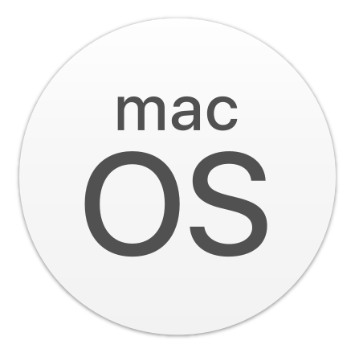
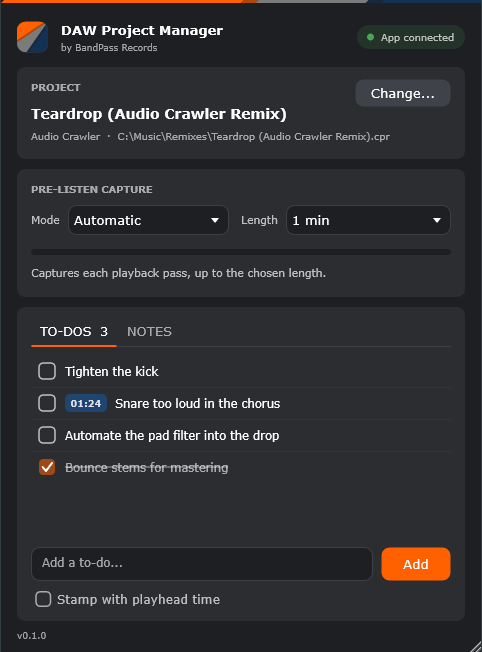

<p align="center">
  
</p>

<h1 align="center">DAW Project Manager plugin</h1>

<p align="center"><b>Your DAW, connected to <a href="https://github.com/bandpassrecords/daw-project-manager">DAW Project Manager</a>.</b></p>

<p align="center">
  <a href="https://github.com/bandpassrecords/daw-project-manager-plugin/releases/latest"></a>
  <a href="https://github.com/bandpassrecords/daw-project-manager-plugin/actions/workflows/release.yml?query=branch%3Amain"></a>
  <a href="https://github.com/bandpassrecords/daw-project-manager-plugin/releases"></a>
  
  <a href="LICENSE"></a>
</p>

<table align="center">
  <tr>
    <td align="center" width="170">
      <a href="https://github.com/bandpassrecords/daw-project-manager-plugin/releases/latest"><br><b>Windows</b></a><br><sub>VST3 · .exe · .zip</sub>
    </td>
    <td align="center" width="170">
      <a href="https://github.com/bandpassrecords/daw-project-manager-plugin/releases/latest"><br><b>macOS</b></a><br><sub>VST3 + AU · .pkg · .zip</sub>
    </td>
    <td align="center" width="170">
      <a href="https://github.com/bandpassrecords/daw-project-manager-plugin/releases/latest"><br><b>Linux</b></a><br><sub>VST3 · .tar.gz</sub>
    </td>
  </tr>
</table>

<p align="center"><a href="https://github.com/bandpassrecords/daw-project-manager">The app</a> · <a href="docs/PROTOCOL.md">How they talk</a> · <a href="docs/development.md">Build it yourself</a></p>

<p align="center"></p>

## What it does

Put it on your master bus:

- **Pre-listen capture.** Each playback pass becomes the project's preview song
  in the app, without bouncing.
- **To-dos and notes in the DAW.** Tick them off, add new ones, stamp one with
  the playhead time (`[01:42] vocal too loud`).
- **Knows which project is open,** from the DAW's window title or the app's
  launch; otherwise pick it from a search.
- **Work sessions.** The app knows when the DAW opens and closes the project.

Audio passes through untouched. In the app's nine languages.

## Install

Download the installer for your system from the
[latest release](https://github.com/bandpassrecords/daw-project-manager-plugin/releases/latest)
and rescan plug-ins in your DAW. The installers use the standard plug-in
folders every DAW scans, for all users or just you. Each file has a `.sha256`.

Coming from **DPM Companion**, the plugin's old name? Installing replaces it,
and DAW projects that use it keep working.

## Use it

1. Insert **DAW Project Manager** on the master bus.
2. Check that it names your project; if not, **Change…** and pick it.
3. Choose how to capture: **Automatic** records each playback pass,
   **Manual** between **Record** and **Stop**.

## Contribute

```bash
git clone https://github.com/bandpassrecords/daw-project-manager-plugin.git
cd daw-project-manager-plugin
cmake -S . -B build -DDPM_BUILD_STANDALONE=ON
cmake --build build --config Debug --target DAWProjectManager_Standalone
```

| | |
|---|---|
| 🛠 [Development](docs/development.md) | build, test, and try it without a DAW |
| 🔌 [Protocol](docs/PROTOCOL.md) | the contract with the app |
| 🧭 [CLAUDE.md](CLAUDE.md) | how the code is organised, validating, releasing |

<sub>AGPL-3.0 · BandPass Records · a separate program from DAW Project Manager (MIT): the two talk only through files</sub>
